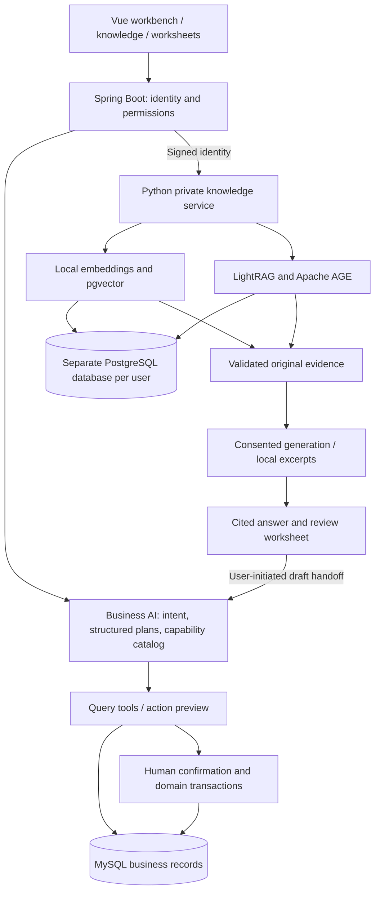

# AI-MES Copilot

[](LICENSE)

**An AI-assisted manufacturing execution system: query operations, retrieve private documents, explore relationships, and carry evidence into confirmed business actions.**

Spring Boot · Vue 3 · MySQL · Python / FastAPI · PostgreSQL / pgvector / Apache AGE · LightRAG

[简体中文](README.md) · [AI architecture (Chinese)](docs/AI_ARCHITECTURE.md) · [Classroom demo (Chinese)](docs/TEACHER_DEMO.md) · [Capabilities](docs/FEATURES.en.md) · [Setup](docs/SETUP.en.md)

The project uses L100 / L200 dimmable lamps as its manufacturing scenario. It connects purchasing, inventory, production, quality, equipment and shipping, with business AI, private RAG, GraphRAG and review worksheets integrated into the existing MES.

## AI capabilities

| Capability | What it does |
|---|---|
| Business queries | Selects permission-aware tools to read current inventory, order, production and quality data; returns structured results and follow-up suggestions. |
| Business actions | Produces a structured plan, checks prerequisites, prepares a preview, waits for confirmation, executes through domain services and verifies the result. |
| Private document RAG | Supports PDF, DOCX, XLSX, TXT and Markdown; retrieves local Chinese embeddings with pgvector and returns versioned source references. |
| GraphRAG and fusion | Uses LightRAG and Apache AGE to retrieve relationships across product, material, process and inspection documents, backed by original text. |
| Graph exploration | Displays actual graph data with search, filters, zoom, relationship paths, source previews and a text list. |
| Review worksheets | Saves answers and evidence, separates human notes and checklist items, rechecks sources before export or business handoff. |
| Conversations and preferences | Maintains private history, role and length preferences, shared workbench/dock drafts and recovery that preserves the next question. |

The business catalog contains **20 query/analysis capabilities and 19 direct action capabilities**. Knowledge retrieval, graphs and worksheets are additional services.


*Historical demonstration capture; figures reflect the sample data used at capture time.*

## Architecture



Live operational questions use business tools; document questions use the current user's valid sources. Models interpret intent and organize language. Application code controls permissions, current facts and transactions.

Document vectors and graph construction have independent readiness states. When the graph is unavailable, ready document retrieval remains usable. Without model configuration or processing consent, local excerpts can still be returned.

See the [architecture walkthrough](docs/AI_ARCHITECTURE.md) for the business-agent sequence, indexing and retrieval pipeline, graph modes, isolation, tradeoffs and linked source code.

## Classroom scenario

```text
L100 → DRV-07 driver board → PROC-DIM assembly → QC-DIM-01 inspection
```

Ask for the current board, inspect its original source, explore the cross-document relationship, then ask whether the unapproved DRV-08 change is effective. Save the conclusion as a worksheet, add human checks and hand it to the business assistant as a draft.

The [sample collection](services/private-assistant/examples/lamp-showcase/README.md) contains ten related synthetic documents and [24 retrieval checks](services/private-assistant/examples/lamp-showcase/questions.json). Build tools produce a five-format bundle. These materials are educational examples, not production or inspection standards.

The [demo guide](docs/TEACHER_DEMO.md) provides an 8–10 minute flow, suggested narration, questions and an offline fallback.

## Existing MES

Purchasing → incoming inspection → component production or component picking → line-side transfer → final assembly → piece-level inspection → finished-goods receipt → outgoing inspection → shipping.

The system retains multi-level BOMs, parent/child work orders, paired inventory transfers, order progress, alerts, automation and multi-step tasks. Local YuNet / SFace authentication connects to the existing account and JWT flow; human-camera acceptance boundaries are recorded separately.


*Historical UI acceptance capture using temporary demonstration data.*

## Run and verify

```powershell
git clone https://github.com/han139242/ai-mes-copilot.git
Set-Location ai-mes-copilot
```

- [Base MES setup](docs/SETUP.en.md): JDK 21, Node.js 24 and MySQL 8.
- [Private-service setup](services/private-assistant/README.md): Python 3.12, PostgreSQL, local model caches and optional configured generation.
- [Verification records](docs/VERIFICATION.md): actual checks grouped by execution date and scope.
- [Stage 2 requirements and acceptance](docs/STAGE2_FINAL_RELEASE.md): feature evidence and remaining on-site checks.

Manual base setup uses frontend 5173 / backend 8088. The isolated Stage 2 launcher uses frontend 5181 / backend 8089 / private service 8091 / PostgreSQL 55432. Prepare the matching databases and private configuration first.

```powershell
Push-Location workspace/vscode/ems-forword
npm ci
npm test
npm run build
Pop-Location
```

Secrets, private originals, face templates and runtime databases are excluded from source delivery. Source validation and citation-ID checks do not prove every generated claim is supported: important conclusions still require reading the original. Offline retrieval checks are distinct from generation evaluation. Dify is not deployed; remaining human-camera scenarios are listed in the acceptance record.

## Source layout

```text
workspace/idea/ems/            Business AI, authorization, domain services and tests
workspace/vscode/ems-forword/  Vue workbench, knowledge, graph and worksheets
services/private-assistant/   Python RAG, GraphRAG, face service and samples
scripts/                      Startup, migrations and verification
docs/                         Architecture, demo, setup and dated evidence
workspace/vx/                 Retained historical WeChat mini-program
```

[Changelog](CHANGELOG.md) · [Contributing](CONTRIBUTING.md) · [Legacy scope](docs/LEGACY.md) · [Third-party notices](services/private-assistant/THIRD_PARTY_NOTICES.md)

## Contributors and license

Thanks to [@han139242](https://github.com/han139242), [@AnHC-00](https://github.com/AnHC-00) and [@zengjingye](https://github.com/zengjingye). See [contributors](CONTRIBUTORS.md).

Original project code is licensed under the [MIT License](LICENSE). Third-party components retain their own licenses and copyright notices.
