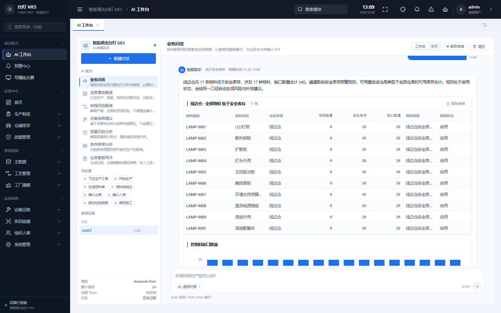
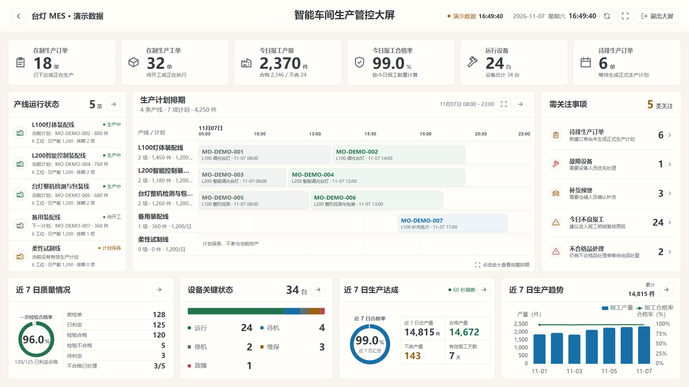

# AI-MES Copilot

The owner removed the former local 20-call validation cap. Existing request records are preserved; `PRIVATE_LLM_LIMIT=0` means no local cap, while provider billing and document-processing consent still apply. The knowledge workspace uses expandable help and reversible settings drafts. See the [current interaction and usage notes (Chinese)](docs/INTERACTION_REFINEMENT.md).

Local stage-2 development now includes username-free face identification, guided capture and ambiguous-match rejection. Existing per-user private templates and MES authorization are preserved. Real-camera acceptance remains pending; see the [implementation and verification notes (Chinese)](docs/FACE_AUTO_CAPTURE.md).

[](LICENSE)

[简体中文](README.md) · English

Use natural language to query manufacturing data, understand problems, carry out supported tasks, and track results.

[Setup](docs/SETUP.en.md) · [AI capabilities](docs/FEATURES.en.md) · [Contributing](CONTRIBUTING.md#english) · [Releases](https://github.com/han139242/ai-mes-copilot/releases)

AI-MES Copilot is a manufacturing execution system built with **Spring Boot, Vue 3, and MySQL**. Its reference business scenario is the production of L100 and L200 dimmable desk lamps. An AI workbench connects purchasing, inventory, production, quality, equipment, and shipment workflows through natural-language requests. The PC interface and the demonstration screenshot use Chinese.

## Highlights

- **Natural language across the production chain.** Create production orders, schedule work, generate parent and child work orders, issue materials, transfer them to line-side locations, dispatch operations, start work, report output, receive finished goods, and ship sales orders.
- **39 registered business capabilities.** The catalog contains 20 query and analysis capabilities and 19 direct business actions. A permission-controlled resource catalog supports additional business-data queries.
- **Multi-turn clarification and structured answers.** The workbench uses conversation context and follow-up questions, and presents business findings, tables, charts, sources, and suggested next steps.
- **Preview → confirm → execute → verify.** Write operations produce a confirmation card. Execution checks permissions, document states, prerequisites, and duplicate requests, then records the outcome for verification.
- **Automation and proactive alerts.** Rule scans, event triggers, multi-step tasks, notifications, and exception handling have traceable execution states.
- **Business consistency.** The system supports multi-level bills of materials (BOMs), component and assembly work orders, paired inventory transfers, piece-level inspections, and an eight-stage order-progress view.



*Screenshot from a project rehearsal. Quantities shown are demonstration data from that run.*

### Production screen and consistent UI

The PC interface uses ivory surfaces with restrained sky-blue accents across navigation, the AI workbench, business tables, and the production screen. Workflow shortcuts follow the production chain. Authenticated sessions use the server catalog; development previews show disabled, clearly labeled shortcut examples.



*UI verification screenshot using temporary demonstration data, not actual operational results. See the [UI conventions (Chinese)](docs/UI_DESIGN.md).*

### Stage 2: grounded private knowledge

Stage 2 adds a separate PostgreSQL database per user, five document formats, versioned citations, vector RAG, LightRAG / Apache AGE graph retrieval and fusion, role preferences, and face enrollment, management, and authentication through the existing MES session. Knowledge answers can prefill the business assistant; existing permissions and preview/confirmation remain in force.

See the [implementation](docs/STAGE2_IMPLEMENTATION.md), [measured checks and outstanding work](docs/STAGE2_ACCEPTANCE.md), [upstream references](docs/STAGE2_REFERENCES.md), and [isolated setup](services/private-assistant/README.md). These documents and the new interface are in Chinese.

The maintainer has enrolled a face and reported successful username-free login. Latest human latency, a second participant, and wrong-person rejection still require on-device acceptance. Dify is an optional extension and has not been deployed. The maintainer removed the local 20-request cap; processing consent, durable accounting, and provider quotas still apply. This maintenance round made no additional paid requests. See the [current requirement checklist and release checks](docs/STAGE2_FINAL_RELEASE.md) (Chinese); older acceptance records retain their dated scope.

The latest refinement adds **relationship-path exploration** over the current authorized graph: choose two entities, inspect an association within six edges, open its current sources, and prefill a question without sending it. Short mobile windows keep the composer visible, while the workbench retains its capability modes and business shortcuts. Portable regressions cover the actual ECharts camera and geometry, shortcut ownership, and todo pagination. See the [refinement record and design references](docs/EXPERIENCE_REFINEMENT.md) (Chinese).

## Example requests

English translations of example requests for the supported workflows:

- “How much did we produce today? How many units passed inspection, and how many were defective?”
- “Which materials are below safety stock, and what are the shortages?”
- “Can this work order start now? Which prerequisites are still missing?”
- “Schedule this production order, then generate its work orders.”
- “Generate the material issue document for this work order, then transfer the materials to the line-side warehouse.”
- “Which stage has this order reached, and what should happen next?”

Actions require an account with the appropriate permissions, existing business objects, and completed prerequisites. The assistant asks for missing document numbers, locations, quantities, or other required information. Quality personnel enter actual piece-level measurements; AI assists with queries, workflow coordination, and submission of results already recorded in the system.

See [AI capabilities and execution boundaries](docs/FEATURES.en.md) for the complete catalog and action flow.

## Business scope

Master data and product processes, warehouse inventory, production execution, quality management, equipment maintenance, team scheduling, purchasing and sales, access control, AI queries and actions, alert automation, and operational dashboards.

The production chain is:

Incoming procurement → incoming inspection → component production / stocked-component issue → line-side material transfer → final assembly → piece-level inspection → finished-goods receipt → outgoing inspection → sales shipment.

## Repository layout

```text
workspace/idea/ems/            Spring Boot backend, domain services, database scripts, and tests
workspace/vscode/ems-forword/  Vue 3 PC frontend, AI workbench, and business pages
workspace/vx/                 Historical WeChat mini-program code
scripts/                      Runtime supervision, migration, rehearsal, and verification tools
docs/                         Setup, capability, quality, and verification documentation
```

The delivered application focuses on the backend and PC frontend. The historical WeChat mini program is retained separately and has its own configuration and maintenance scope.

## Getting started

The complete development and verification environment uses **JDK 21**, **Node.js 24** (verified with 24.19.0), **MySQL 8.0**, and Python 3 for selected migration and verification tools. Redis is optional. Frontend build dependencies allow some older Node versions; the [setup guide](docs/SETUP.en.md) distinguishes build compatibility from the complete conversation-test requirements.

```powershell
git clone https://github.com/han139242/ai-mes-copilot.git
Set-Location ai-mes-copilot
```

Follow the [English setup guide](docs/SETUP.en.md) to create an isolated demo database, apply migrations in order, and configure environment variables. It includes backend and frontend startup commands, AI configuration, production-build notes, and common setup problems.

The default development ports are **8088** for the backend and **5173** for the frontend. Start with `AI_ENABLED=false` to use ordinary business modules; configure your own model service when enabling the AI workbench. Keep AI keys and database credentials in backend environment variables.

## Tests and builds

PC frontend, from the repository root:

```powershell
Push-Location workspace/vscode/ems-forword
npm ci
npm test
npm run build
Pop-Location
```

Runtime supervision and execution preflight tools:

```powershell
node --test scripts/local-runtime.test.mjs scripts/ai-decision-preflight.test.mjs
```

For the backend, first initialize a separate test database and configure its environment variables using the [setup guide](docs/SETUP.en.md#backend-integration-tests). Then run:

```powershell
Push-Location workspace/idea/ems
.\mvnw.cmd -B package
Pop-Location
```

On Linux/macOS, run `./mvnw -B package` from the backend directory. Integration tests write test data, so use a database isolated from normal demonstrations and business data.

The corresponding business source completed **1,118 backend tests with zero failures, errors, or skipped tests** and packaging in an isolated verification environment after the November 2, 2026 CodeArts cleanup. The same verification round recorded 71 frontend tests and a production build, 20 runtime/preflight checks, and four Python-tool tests. These are dated execution records; each scope is recorded separately in [VERIFICATION.md](docs/VERIFICATION.md), currently in Chinese. The November 3 documentation-only release did not rerun that regression.

The November 5, 2026 conversation-usability update passed **1,134 backend tests**, **74 frontend tests**, and **20 runtime/preflight checks**, with backend packaging and the frontend production build passing. Its real-model evaluation used the authorized limit of **20 requests**. Recorded scenarios and the equivalent-query routing difference are described in the [usability review](docs/AI_USABILITY.md).

## Documentation

- [Environment, database initialization, and startup](docs/SETUP.en.md)
- [AI catalog, confirmation flow, and business boundaries](docs/FEATURES.en.md)
- [Contribution workflow and checks](CONTRIBUTING.md#english)
- [Contributors](CONTRIBUTORS.md)
- [Validation records — Chinese](docs/VERIFICATION.md)
- [CodeArts cleanup notes — Chinese](docs/CODE_QUALITY.md)
- [Conversation usability review — Chinese](docs/AI_USABILITY.md)
- [Changelog — Chinese](CHANGELOG.md)

The public repository includes source code, database migrations, and example data. Personal coursework, student identifiers, presentation material, shared-database credentials, local runtime state, and private repository history are kept outside the public source.

## Contributors

Thanks to the project contributors:

- [@han139242](https://github.com/han139242)
- [@AnHC-00](https://github.com/AnHC-00)
- [@zengjingye](https://github.com/zengjingye)

Public credits use GitHub usernames. See [CONTRIBUTORS.md](CONTRIBUTORS.md) for attribution and future participation.

Community contribution: [@YuuGR1337](https://github.com/YuuGR1337) added the English documentation entry in [PR #4](https://github.com/han139242/ai-mes-copilot/pull/4).

## Project status

The coursework delivery is complete, and the source remains available for community maintenance. Report reproducible problems through [Issues](https://github.com/han139242/ai-mes-copilot/issues), or submit a focused pull request. See [Contributing](CONTRIBUTING.md#english) for the workflow and [Releases](https://github.com/han139242/ai-mes-copilot/releases) for published source packages.

## License

Original project code is licensed under the [MIT License](LICENSE). Use, modification, and commercial use are permitted subject to retaining the copyright and license notices. Third-party dependencies retain their respective licenses and copyright notices.
