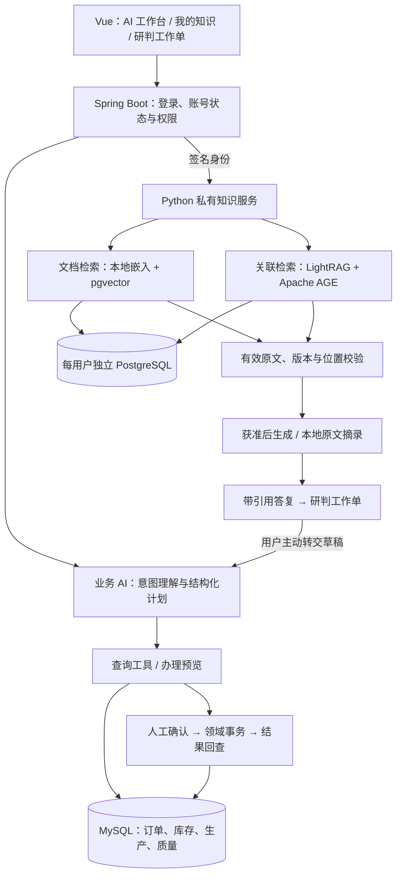
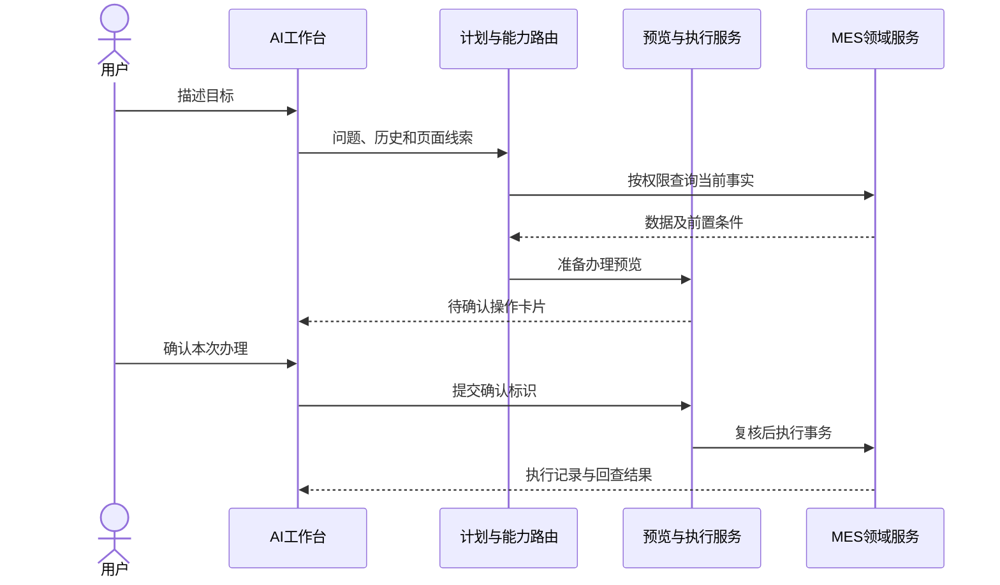
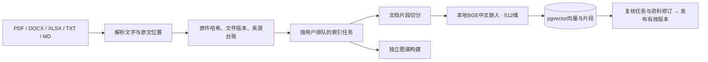
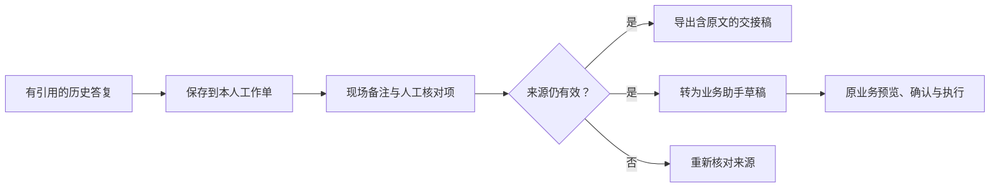

# AI 架构：从业务问题到有依据的办理

[项目首页](../README.md) · [教师演示与讲解](TEACHER_DEMO.md) · [功能目录](FEATURES.md)

本文对应当前源码，重点说明 AI 怎样接入 MES、怎样使用私有知识，以及怎样把回答衔接到业务。

## 1. 总体架构

AI-MES Copilot 有两条主要 AI 路径：**业务助手**处理实时查询与办理，**私有知识助手**处理文件中的规定、知识与关联。两者共享原系统登录与权限，通过用户主动转交草稿衔接。

| 层次 | 主要职责 | 实现 |
|---|---|---|
| 交互层 | 问答、快捷办理、引用、图谱、工作单 | Vue 3、Element Plus、ECharts |
| 业务与身份层 | JWT、权限、能力目录、计划、预览与执行 | Spring Boot、MySQL |
| 私有知识层 | 解析、索引、检索、来源校验、工作单、偏好 | Python / FastAPI |
| 私有存储层 | 本人原件、向量、图谱、历史与工作单 | 每用户独立 PostgreSQL 数据库、受限角色、文件目录 |
| 模型层 | 本地嵌入，大模型计划/抽取/生成，本地人脸特征 | FastEmbed / BGE、兼容 API、YuNet / SFace |



“当前库存多少”由业务工具读取数据库；“检验规范怎么规定”由知识服务检索原文。模型负责理解、计划和组织语言，程序负责权限、数据读取和业务执行。

## 2. 业务 Agent：理解目标，再调用已有能力

例如：“先看看这张工单还缺什么，能开工再帮我准备。”

1. **收集上下文。** 接收问题、会话历史和获准页面线索。历史帮助理解“这张”“刚才”，当前状态重新查询。
2. **选择能力。** 结合意图路由与模型计划，从受权限过滤的目录选择工具。目录包含 20 项查询分析与 19 项直接办理。
3. **形成结构化计划。** `AiPlan` 包含 `mode`、`capability`、`params`，多步办理另有 `steps`。模式为 `query`、`command`、`clarify`、`chat`。
4. **查询和核查。** 注册工具或受控资源目录读取真实业务。缺少对象或必填参数时澄清；根据观测补查时，代码限制最多三轮工具查询。
5. **预览后确认。** 用户看到目标与前置条件。确认请求进入业务执行服务，再次校验权限、状态和重复请求。
6. **执行后回查。** 生产、库存、质量领域服务完成事务，助手根据实际执行结果解释下一步。



这里的 Agent 围绕已注册工具规划和交互。模型计划仍需后端验证，不能直接获得任意 SQL 或任意业务写入能力。规则预警、事件触发和多步任务使用已有编排服务，其执行受已配置规则和业务权限约束。

## 3. 文档 RAG：把问题带到可定位的原文

RAG（检索增强生成）的过程是先找资料，再根据资料组织答案。入库与问答分开执行。

### 入库链路



- PDF 保留页码，DOCX 保留段落/表格位置，XLSX 保留工作表与单元格，文本保留行号。
- 文档向量按来源片段取约 240 字符、重叠 40 字符；图谱输入使用独立的 tokenizer 限长与合并逻辑，两种切块不能混为一谈。
- 文本由本地模型变成 512 维向量，写入 `knowledge_chunks.embedding`。原件、哈希、版本和位置共同支持回读。
- 更新先创建候选版本，索引成功且任务仍有效后才发布。失败继续使用已发布旧版，并说明所用版本。
- 扫描件走独立的识别与校对入口。用户选择可外发的页面，服务本机渲染后送 OCR，核对文字后才进入同一索引队列。引用保留原始页码，可打开对应版本的扫描原页。

### 问答链路

1. 从本人私有库读取有效资料、偏好和同一会话的有效历史。
2. 判断是否需要实时 MES 数据；命中后返回业务助手转交入口。
3. 本地嵌入问题，以 pgvector 余弦距离召回原文，再按明确编号、问题涉及的证据类型和来源覆盖排序，限制单文件占用的候选数量。
4. 从本人已发布的原文中补查遗漏编号。多编号对比仍缺证据时先展示已有原文和缺失编号。
5. 合并为最多 10 条来源，每条带文件 ID、版本、哈希、位置和原文。
6. 有来源、模型配置完备且用户同意处理后，发送命中片段及必要上下文生成；否则展示本地原文摘录。
7. 检查生成文本中的引用编号。缺少引用或使用未知编号时退回已核对原文；保存前再次核对资料和授权修订。

**实际边界：** 系统检查来源身份、版本、位置、原文和引用编号，尚未实现逐句语义蕴含校验。有效的 `[S1]` 不能单独证明整句话正确，关键判断仍应打开原文核对。

## 4. GraphRAG：组织跨文件的关系证据

普通文档检索适合找“哪段资料说了这件事”。跨产品、物料、工序和检验规范的问题，还需要关系线索辅助定位。

```text
产品资料：L100 使用 DRV-07
BOM / 装配：DRV-07 对应 PROC-DIM
检验资料：PROC-DIM 引用 QC-DIM-01

融合提问：L100 驱动板异常时，应沿哪些工序和检验依据排查？
```

**构图。** LightRAG 从获准资料中抽取实体和关系；领域类型覆盖产品、物料、工序、设备、故障、标准、岗位。编号经保守规范化，Apache AGE 在本人 PostgreSQL 数据库中存图。构图使用候选代际，来源和任务检查通过后切换有效图。

**检索。** 服务调用 LightRAG `aquery_data` 获取实体、关系和片段，再核对原文。融合优先保留排序后的关键文档片段，并纳入已核对的图谱来源。实际批次的投入、产出和数量由业务工作台读取 MySQL 的用料追溯记录。

| 界面方式 | 当前实现 |
|---|---|
| 自动 | 根据“关联、影响、链路、追溯”等特征选择文档或融合，当前是规则选择 |
| 文档 | 本地向量检索，适合配置、定义和步骤 |
| 图谱 | 通过图检索关联证据并核对原文，可补充本地文档来源 |
| 融合 | 结合图关系与文档片段，支持跨文件关联解释 |

图谱未就绪、检索出错或缺少可追溯依据时，显示实际降级方式和原因。文档向量层独立工作，图构建失败不阻断已就绪文档。GraphRAG 的收益取决于资料和问题类型，当前没有证明它在所有问题上更准确。

**可视化。** ECharts 展示后端实际图数据，提供搜索、类型筛选、缩放、相邻关系、来源预览和文字列表。路径探索查找当前可见图中六段以内的最短关联，不等于全库无限深度推理。

## 5. 研判工作单：从答案到可交接材料



后端从本人真实历史读取答复与来源，浏览器不能自造事实快照。人工备注和核对项与原答复分开保存；版本冲突时保留草稿。导出和转业务前复核来源，失效依据不能继续用于办理。

工作单辅助研判和交接。检验实测值由人员录入，库存及单据状态来自 MES。转交只填入草稿，不自动发送或确认。

## 6. 用户隔离与模型请求

- **可信身份：** Spring Boot 取认证用户 ID，用请求体摘要、时间和随机值作 HMAC 签名；Python 验签和防重放后选择私有库。
- **一人一库：** 每用户有独立 PostgreSQL 数据库、非超级用户角色与原件目录；历史、图谱、偏好、工作单和文件按本人身份访问。LightRAG 子进程固定用户与代际。
- **版本撤销：** 更新或删除改变来源有效性，旧回答标为失效，不作为新事实；删除共享来源时保留其他仍有效依据。
- **任务一致性：** 队列、取消、有限重试、跨进程租约与代际检查约束索引发布，旧任务不能覆盖新版本。
- **模型同意：** 本地嵌入留在本机；云端抽取处理获准资料，生成处理命中片段。外发前复核同意、来源和任务，密钥只在后端。
- **调用记录：** 实际模型 HTTP 尝试持久记录，包括失败请求。`PRIVATE_LLM_LIMIT=0` 为无本地上限，正数可配置限额；平台额度与资料授权仍适用。`-NoCloud` 用于离线维护。

人脸认证使用本地 YuNet / SFace 的 128 维特征，与文本 512 维分别管理。核验后回到原 JWT 与账号状态流程。动作检查不等同于专业活体防伪，真人验收范围见[人脸说明](FACE_AUTO_CAPTURE.md)。

### 可选的 DeepSeek 应用工具

在工作台和知识页分别提供公开资料、语音转写与答复朗读，扫描件从知识页入库。Spring Boot 复用 MES 权限和签名机制，Python 只调用指定的独立工具接口并记录调用结果。公开网页结果在工具窗口查阅，转写只填入草稿，知识答复朗读会复核本人答复和处理同意。扫描件校对后继续走私有文件版本和本地向量索引；图谱抽取按原有同意配置运行。能力选择、外发范围、价格和验证见[DeepSeek 接入调研](DEEPSEEK_APPLICATION_20261114.md)。

## 7. 技术取舍与验证

| 取舍 | 原因和影响 |
|---|---|
| 原 Spring Boot 加独立 Python 服务 | 复用业务权限与事务，接入 Python 解析、嵌入和 LightRAG 生态 |
| 文档向量与图构建解耦 | 图模型失败时保留已就绪原文查询 |
| PostgreSQL 承载 pgvector 和 AGE | 在每用户库保存两类索引，减少额外图数据库；仍需管理扩展兼容和用户库数量 |
| 来源校验与受控工具 | 缩小旧版本引用、无依据回答和越权执行范围，仍需真实场景评估 |
| 已有知识页中增加工作单 | 复用引用、账号隔离和业务确认，形成完整演示链路 |

验证分为前端交互回归、Python 真实 PostgreSQL 集成、Java 网关和业务检查、本地检索、有限生成样例及浏览器检查。**离线检索通过率不等于生成准确率。** 各轮分母和本轮结果见[验证说明](VERIFICATION.md)。

## 8. 关键代码入口

| 关注点 | 源码 |
|---|---|
| 能力目录与计划 | [AiCapabilityCatalog.java](../workspace/idea/ems/src/main/java/com/neuedu/ems/service/ai/AiCapabilityCatalog.java)、[AiPlan.java](../workspace/idea/ems/src/main/java/com/neuedu/ems/service/ai/AiPlan.java) |
| 业务计划与工具编排 | [AiPlannerServiceImpl.java](../workspace/idea/ems/src/main/java/com/neuedu/ems/service/impl/ai/AiPlannerServiceImpl.java)、[AiServiceImpl.java](../workspace/idea/ems/src/main/java/com/neuedu/ems/service/impl/ai/AiServiceImpl.java) |
| 预览与执行 | [AiCommandServiceImpl.java](../workspace/idea/ems/src/main/java/com/neuedu/ems/service/impl/ai/AiCommandServiceImpl.java) |
| 身份网关 | [PrivateAssistantController.java](../workspace/idea/ems/src/main/java/com/neuedu/ems/controller/ai/PrivateAssistantController.java)、[PrivateAssistantClient.java](../workspace/idea/ems/src/main/java/com/neuedu/ems/service/impl/ai/PrivateAssistantClient.java) |
| API、私有库与文件生命周期 | [app.py](../services/private-assistant/assistant/app.py)、[database.py](../services/private-assistant/assistant/database.py)、[knowledge.py](../services/private-assistant/assistant/knowledge.py) |
| 解析与向量 | [parsing.py](../services/private-assistant/assistant/parsing.py)、[vectors.py](../services/private-assistant/assistant/vectors.py)、[chunking.py](../services/private-assistant/assistant/chunking.py) |
| 扫描校对与独立工具 | [scans.py](../services/private-assistant/assistant/scans.py)、[deepseek.py](../services/private-assistant/assistant/deepseek.py) |
| LightRAG 与领域约束 | [worker.py](../services/private-assistant/assistant/worker.py)、[ontology.py](../services/private-assistant/assistant/ontology.py) |
| 回答与请求授权 | [answers.py](../services/private-assistant/assistant/answers.py)、[llm.py](../services/private-assistant/assistant/llm.py)、[job_policy.py](../services/private-assistant/assistant/job_policy.py) |
| 工作单 | [review_notes.py](../services/private-assistant/assistant/review_notes.py)、[ReviewNotebook.vue](../workspace/vscode/ems-forword/src/components/ai/ReviewNotebook.vue) |
| 知识页、图谱与会话 | [private-knowledge.vue](../workspace/vscode/ems-forword/src/pages/ai/private-knowledge.vue)、[KnowledgeGraph.vue](../workspace/vscode/ems-forword/src/components/ai/KnowledgeGraph.vue)、[aiConversation.js](../workspace/vscode/ems-forword/src/stores/aiConversation.js) |

上游版本、许可和具体采用范围见[开源参考](STAGE2_REFERENCES.md)与[第三方声明](../services/private-assistant/THIRD_PARTY_NOTICES.md)。
