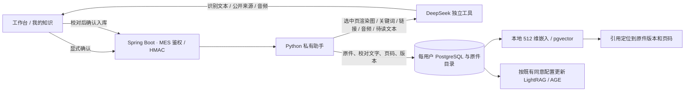

# DeepSeek 应用能力调研与 AI-MES 接入

[AI 架构](AI_ARCHITECTURE.md) · [教师演示](TEACHER_DEMO.md) · [部署与配置](../services/private-assistant/README.md)

## 11 月 13 日更新了什么

DeepSeek 将应用侧的联网搜索、网页读取、文件处理、语音与内容安全开放到 API。模型内置工具面向 `deepseek-flash`，支持 Chat Completions、Responses 和 Messages；独立 Search API 已于 10 月 17 日开放。对 AI-MES，新增价值最大的是**让扫描的质检规程也能被检索，并可从答案回到原始页**。公开资料和语音也接入现有工作区，分别服务于资料查阅和现场输入。 [更新日志](https://api-docs.deepseek.com/updates/#date-2026-11-13) · [官方接入总览](https://api-docs.deepseek.com/guides/build_a_chatbot/)

## 接入决策

| 能力 | AI-MES 的实现与依据 |
|---|---|
| 独立 OCR | 选择 PDF、PNG 或 JPEG，先本机检查页码。混合 PDF 默认建议无文字层的页，用户可手动补选。确认后只发送所选页的渲染图，保留本机文字；OCR 截断、缺页或重复页会阻止进入校对。核对型号、批次号、数字与单位后才创建版本和索引任务。相同原件局部重做时保留其他已校对页。点击引用可查看对应版本的扫描原页。 [OCR API](https://api-docs.deepseek.com/guides/ocr/) |
| 独立 Search / Fetch | “公开资料”只提交当前输入的公开关键词或明确选择的链接。显示标题、域名、原网页和摘要，允许在应用内读取已配置的 HTTPS 站点正文。正文以文本展示，查阅结果不自动入库，也不进入业务计划。 [Search / Fetch API](https://api-docs.deepseek.com/guides/search/) |
| 独立 ASR | 浏览器可录 30 秒，或选择合规 WAV。用户点击转写才发送，核对后填入问答草稿，保留既有文本。车间编号和数值须人工核对。浏览器录音需要 HTTPS 或本机访问。 [ASR API](https://api-docs.deepseek.com/guides/asr/) · [W3C 媒体采集规范](https://www.w3.org/TR/mediacapture-streams/) |
| 独立 TTS | 用户看到待发送文本后点击合成，最长 600 字。WebSocket 收到成功终帧后才生成可播放的 WAV，页面由用户手动播放。私有知识答复在发出文字前再次检查本人历史、版本、可见答复和模型处理同意。 [TTS API](https://api-docs.deepseek.com/guides/tts/) |
| 模型内容审核 | 连接官方 `deepseek-flash` 时可配置 `safety_check=high`。识别提供方的内容拒绝后返回安全提示；业务计划拒绝时不生成执行命令。Spring Boot 仍负责账号权限和业务确认。 [安全审核指南](https://api-docs.deepseek.com/guides/safety/) |
| 云 Files 与模型自动联网 | 云文件解析依赖平台账户下的 `file_id`，对话可携带解析全文。本项目的普通文件解析、版本、授权和原文回读留在本机。模型内置联网可由模型发起多次搜索，适合开放式对话；本项目选择由用户单独提交搜索词或链接，便于核对每次外发。 [文件解析指南](https://api-docs.deepseek.com/guides/document_parsing/) · [模型内置联网](https://api-docs.deepseek.com/guides/web_tools/) |
| 会话标题与用户环境 | 保留 MES 已有的会话命名、账号权限、语言和业务时间解析，省去模型生成标题和上传位置或语言标记。 [会话标题](https://api-docs.deepseek.com/guides/conversation_title/) · [用户环境标记](https://api-docs.deepseek.com/guides/latest_reminder/) |
| 开源对话前端 | 官方 MIT 演示用于参考工具交互，包含浏览器 Key 设置与历史导入。AI-MES 的密钥留在 Python 服务，继续按 MES 账号管理会话。 [官方 Chat Demo](https://github.com/deepseek-ai/chat-demo) |

## 数据流与限制

- OCR 每份原件上限 8 MiB，每次最多选 24 页。PDF 渲染需要 `pdftoppm`；图片可直接识别。提交校对结果时核对本人、文件哈希和当前版本，重复提交返回同一入库回执。
- Search 接受 1～128 字符并返回最多 6 条；Fetch 只读取配置域名的无查询参数 HTTPS 链接，正文最多显示 12,000 字。公开来源可通过链接核对，无法替代现场单据、私有规程及其版本依据。
- ASR 接受完整的 16 位单声道 WAV，上限 30 秒、4 MiB；TTS 上限 600 字。工具调用共用服务端并发上限和现有请求台账。网络错误由用户决定是否再试；停止浏览器等待后，已送达的平台请求仍可能完成和计费。
- 外发前应确认内容有权交给服务提供方。默认工具关闭，`-NoCloud` 同时禁用原模型和新工具。扫描件确认前只到本机服务；发出的渲染图仍含页面可见内容。 [DeepSeek 开放平台服务协议](https://cdn.deepseek.com/policies/zh-CN/deepseek-open-platform-terms-of-service.html)

## 价格口径

按 2026 年 11 月 14 日查阅的官方人民币价目，独立搜索和网页读取各 ¥5/千次成功调用，OCR ¥1.5/千页，ASR 标价 ¥0.78/小时，TTS 标价 ¥3/万计费字符。页面显示语音优惠价分别为 ¥0.39/小时和 ¥1.5/万计费字符，汉字按两个计费字符计算。普通模型生成按模型价格计费，高等级内容审核的用量计入输出 token。本次开发验证未用真实 API Key。 [DeepSeek 模型与工具价格](https://api-docs.deepseek.com/zh-cn/quick_start/pricing/) · [内容审核计费](https://api-docs.deepseek.com/guides/safety/#billing)

## 复验

后端代码从 [DeepSeek 工具适配](../services/private-assistant/assistant/deepseek.py)、[扫描件处理](../services/private-assistant/assistant/scans.py)、[签名分发](../services/private-assistant/assistant/app.py) 与 [Java 鉴权网关](../workspace/idea/ems/src/main/java/com/neuedu/ems/controller/ai/PrivateAssistantController.java) 进入。界面入口在[扫描件对话框](../workspace/vscode/ems-forword/src/components/ai/ScanImportDialog.vue)和[公开资料与语音对话框](../workspace/vscode/ems-forword/src/components/ai/DeepSeekToolsDialog.vue)。

- Python 运行 `python -m pytest tests/test_deepseek_tools.py`。启用 `PRIVATE_INTEGRATION=1` 并配置独立 PostgreSQL 和本地模型缓存，可检查扫描校对入库、向量召回、历史原页和跨账号隔离。带共享资源的合成 PDF 验证只发选中页像素；缺少 Poppler 时该专项测试会跳过。
- 在 `workspace/vscode/ems-forword` 运行 `npm test` 和 `npm run build`，分别检查前端逻辑与产物，构建会单独打包录音工作线程。
- Java 测试至少覆盖 `PrivateAssistantControllerTest` 和 `AiPlannerServiceImplTest`，检查认证身份、工具操作、确认字段和模型拒绝后的计划结果。完整离线演示仍按[教师讲稿](TEACHER_DEMO.md)复验现有 RAG、图谱和业务查询。

模拟上游覆盖了输入边界、响应格式和失败处理，真实 OCR 识别率、车间噪声下转写准确率、平台响应时间与账号可用额度需要联网试用后测量。
