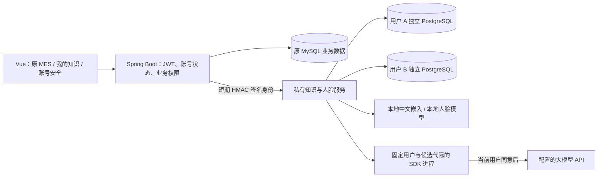

# 阶段 2：设计与实现

阶段 2 扩展原台灯 MES，私有资料和人脸使用独立服务，业务权限、库存与生产事务、AI 快捷办理和预览确认沿用原入口。总体数据流与新增工作单见[AI 架构](AI_ARCHITECTURE.md)，当前检查见[验证说明](VERIFICATION.md)，分轮历史见[验收记录](STAGE2_ACCEPTANCE.md)。

## 1. 设计思路

教师要求覆盖人脸认证、私有 RAG、GraphRAG 与图谱；Dify 工作流是加分探索。本项目采用“原 MES 管身份和业务，独立服务管私有知识与认证特征”，避免把知识库变成第二套库存、订单主库。

选型、上游代码入口、采用和未采用的边界见 [参考清单](STAGE2_REFERENCES.md)。实际依赖、镜像和模型版本见 [服务说明](../services/private-assistant/README.md)。

## 2. 身份、私有库与权限

`PrivateAssistantController` 从已认证请求属性读取用户 ID，替换浏览器可控身份。`PrivateAssistantClient` 对完整请求体摘要、时间和随机值签名；Python 验签、过期检查和持久随机值去重后，才按可信用户 ID 打开数据库。

每人有自己的数据库、登录角色和文件目录。角色不是超级用户，不能建角色或数据库，另一用户数据库撤销 PUBLIC CONNECT。SDK 进程固定用户数据库与 workspace，不能在一个并发进程中临时修改全局连接环境来切换身份。

数据库初始化跨进程串行，并记录 schema 版本。当前 schema 只做快速版本检查，不在正常请求期间重复执行 DDL，避免首次初始化与原文读取发生死锁。源 MySQL 库不参与这套迁移。

“我的知识”沿用 `ai:assistant:use`。质检等已有 AI 权限的岗位可以使用；原操作工受限角色继续被拒绝，不因本轮功能扩大业务权限。账号安全是本人认证设置；管理员重置另查 `sys:user:reset-password`，前端账号列表还需要查看用户权限。

## 3. 文件到向量及可靠更新

- 支持 PDF、DOCX、XLSX、TXT、MD，分别保留页码、段落/表格、工作表单元格和文本行号。
- 单文件 8 MB，单库 50 份，原件及版本配额 128 MB；Office 解压量与表格范围有界。空文件、损坏/加密文件、无文字 PDF 不标为索引成功。
- 原件使用服务端生成路径和哈希；下载及预览先核对本人归属、版本、路径和原件校验值。
- 最新上传版本与已发布问答版本分离。候选嵌入成功后，向量、有效版本和回答修订号在事务内切换；失败继续使用已发布旧版，界面明确“沿用 vN”。
- 原件丢失时，相同文件更新可恢复；损坏副本不覆盖，正确文件生成新版本。
- 图抽取与本地向量独立。图服务超时、额度不足或抽取失败时，已就绪文档仍可检索。

文本实际存入 `knowledge_chunks.embedding vector(512)`，通过 pgvector 余弦距离召回，再结合明确编号排序。最终有效引用必须含问题的目标编号；未知或已删除的 `L900`、`PROC-DIM` 等不能悄悄替换成相近编号。

## 4. 图谱、模式与引用

LightRAG 使用 PostgreSQL KV、向量及 AGE 存储。每次图构建使用新的候选代际；仅在当前文件修订、处理同意与任务状态仍有效时发布。实体分类覆盖产品、物料、工序、设备、故障、标准、岗位。

名称保留明确编号。保守规范化只合并“同一编号 + 类别前后缀”，如“装配工序 PROC-DIM”与“PROC-DIM”；不同编号、不同实体类型或无明确编号的名词不猜测合并。SDK 合并返回失败或实际节点未按预期变更时，候选图不发布。

自动、文档、图谱、融合四种选择对应真实检索路径。图模式没有可追溯依据时降为文档，并显示原因；图关系是定位线索，答案事实仍需原文支持。引用检查文档 ID、有效版本、哈希、真实定位及片段内容。

前端复用 ECharts，支持缩放、搜索、类型筛选、节点/关系详情、相邻两跳和可访问文字列表。点击引用可相邻预览同一版本原文；图谱和文档变化时撤销旧画布及旧回答的有效状态。

## 5. 缓存、删除与并发

只有提供方、模型、嵌入与抽取管线签名一致，且来源 ID / 版本 / 哈希仍在当前白名单内，才复用 `extract` 缓存。回答和关键词缓存不参与这套复用。

SDK 可能让多个相同片段共用一个缓存键。保留时同时核对 chunk 的 `llm_cache_list`，保存所有仍有效的来源台账；删除最初的缓存归属文件后，可以改由另一份有效来源承接。连续删除重复来源仍需再次做白名单检查。

删除立即撤销文件检索资格、向量、旧图及失效缓存，并清理全部版本原件。仅仍有效文件的抽取缓存及其来源台账可留在独立保留工作区，供本地重建；它不成为可查询旧图。旧回答保留为失效历史，不再用于模型上下文，用户可单独清除本人问答历史。

任务支持排队、取消、有限重试、重启恢复与超时收尾。普通锁竞争有短暂有界等待；整个任务异常路径都转为可恢复状态，避免卡在永久“运行中”。

## 6. 模型同意与请求预算

云模型建图会处理待抽取文字，问答会处理命中片段；不同用户的历史、资料和缓存不混用。偏好与页面线索只作为数据，不获得任何业务授权。生成文本按文本和安全引用组件渲染，不使用 `v-html`。

每次外发前重新检查当前文件修订、用户同意和任务状态。授权锁覆盖预算预留及实际请求体发送，发送完成即释放，避免等待模型时锁住用户。HTTPS 代理 CONNECT 不被当作模型 POST；已发送的内容无法撤回，撤销会阻止后续请求。

所有实际 HTTP 尝试先在 SQLite 持久计数，包含失败、抽取、关键词和生成。当前 `PRIVATE_LLM_LIMIT=0` 表示不设本地次数上限，正数可配置限额；旧有限签名任务仍受原上限约束。原业务 AI 通过受认证的本机适配器计入同一记录，真实模型密钥只留在 Python 后端。维护使用 `-NoCloud`，不因取消上限自动取得收费验证授权。

未同意、未配置或达到上限时显示可核对原文与明确原因。无依据时不调用模型。实时业务问题带原话转到原 AI 工作台，不自动提交；实际写入仍走原权限、操作预览、人工确认与回查。

## 7. 人脸认证

本人先通过原密码验证并明确同意，主动开启摄像头，完成正面和随机左右轻转头三帧。服务端检测单人脸、姿态与清晰度，对齐后提取 SFace 128 维特征。浏览器上传“已通过”或自带向量均不能作为认证结果。

`face_template.embedding vector(128)` 是真实可检索向量，受本人数据库角色与服务接口限制；另存加密特征附件。加密附件不代表向量字段也已加密。原始照片不写入文件、数据库或大模型请求，前端关闭、取消与卸载时释放摄像头并清除帧。

挑战短期、一次性，拒绝过期与精确画面重放；允许同一人的新采集画面重登，不能把人脸相似本身当重放。通过后仍核对原账号启用/锁定状态并签发原 JWT，注销复用原撤销机制。本人可重录/解绑，管理员可重置并留审计，接口不返回模板或相似度。

这属于基础动作检查，不是专业活体防伪。已有本人录入及维护者反馈的登录成功；第二位参与者、错误脸及最新真人耗时仍需现场核验，详见[人脸说明](FACE_AUTO_CAPTURE.md)。合成向量测试不证明识别准确率。

## 8. 代码入口

| 关注点 | 源码 |
|---|---|
| 身份网关 | `workspace/idea/ems/src/main/java/com/neuedu/ems/controller/ai/PrivateAssistantController.java`、`service/impl/ai/PrivateAssistantClient.java` |
| 人脸与原登录 | `controller/sys/FaceAuthController.java`、`service/impl/sys/AuthServiceImpl.java`、`filter/JwtAuthenticationFilter.java` |
| 数据库与生命周期 | `services/private-assistant/assistant/database.py`、`knowledge.py` |
| 向量与图谱 | 同目录 `vectors.py`、`worker.py`、`ontology.py` |
| 回答与预算 | 同目录 `answers.py`、`llm.py`、`security.py`、`model_proxy.py` |
| 人脸 | 同目录 `face.py` |
| 知识界面 | `workspace/vscode/ems-forword/src/pages/ai/private-knowledge.vue`、`components/ai/KnowledgeGraph.vue` |
| 认证界面 | `src/pages/account/security.vue`、`src/components/auth/FaceCaptureDialog.vue`、`src/pages/login/index.vue`，相对 PC 前端目录 |

部署、失败恢复、验收边界和实际分工分别见服务 README、[验收记录](STAGE2_ACCEPTANCE.md)、[演示步骤](STAGE2_DEMO.md)。
