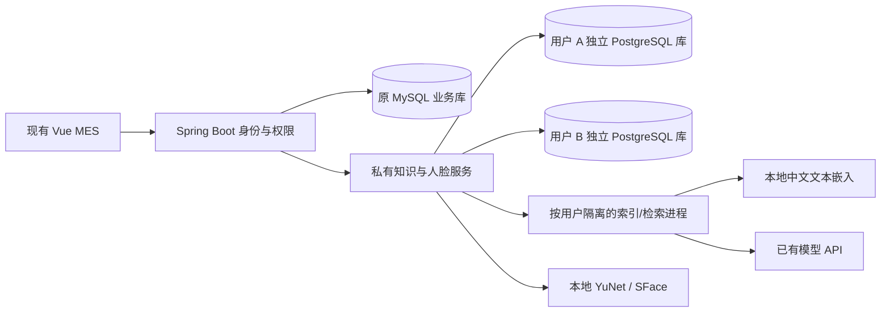

# 第二轮升级：私有知识与图谱助手

本轮从 `bc3d955` 的台灯 MES 开始，开发分支为 `feat/stage2-private-assistant`。保留现有订单、库存、生产、质量、设备、权限、39 项 AI 能力和米白 UI。本文是实施与验收计划，未通过验证的项目不能标为完成。

2026-11-07 已重新核对教师 PDF 和补充图片。开源仓库、具体复用内容、代码入口、版本和许可见 **[STAGE2_REFERENCES.md](STAGE2_REFERENCES.md)**。规划、安装、集成和运行验收分别记录。

## 发布整合前实施记录（2026-11-08）

以下保留当日各阶段快照，包括当时未推送、次数上限和测试分母。[最终复核与发布检查](STAGE2_FINAL_RELEASE.md)是最新状态入口；历史快照不表示当前仍受20次限制或功能仍未上传。

最新授权：维护者取消原20次验证上限，默认无本地次数限制，原记录保留。本轮知识问答/设置精简、104项前端、25项模型边界检查及实际页面结果见[交互与调用策略](INTERACTION_REFINEMENT.md)。维护没有新增收费请求，后文旧限额与计数按各阶段过程保留。

最新反馈与增量：免账号人脸已获维护者反馈可登录，本轮针对等待偏长优化模型复用、重复查询与轮询节奏；前端101项、具体组件前后对比和Python复测边界见[人脸采集与提速](FACE_AUTO_CAPTURE.md)。下文前轮计数作为当轮记录保留，不替代本轮结果。

已在独立环境贯通每用户数据库、五格式资料管理、真实向量 RAG、LightRAG / AGE 图谱、来源版本、岗位偏好、MES 草稿转交和人脸管理/认证代码。原 MES 保留，新版使用 5181 / 8089 / 8091，独立 PostgreSQL 使用 55432。代码仍在本地开发分支，未推送远端。

当前检查：前端**100项通过**且构建成功；免账号人脸登录的认证、权限、原账号服务与网关Java增量**43项**通过并打包。Python全套56项首跑55通过、1项专用库初始化连接超时，环境复核后失败项及相关边界复测3/3通过；不把重跑与原分母重复相加。真实部署的无脸拒绝、管理鉴权、模板不变和预算不变已核对，详见[人脸采集与识别](FACE_AUTO_CAPTURE.md)。前轮Java1140项、真实网关21项和离线80/80的记录保留，不重复计为本轮新运行。累计真实模型 HTTP 尝试20/20，包含2次旧配置认证失败，已停止新增请求。7份生成答复样例与离线80题分开报告。其他体验与解压复核见[体验优化记录](EXPERIENCE_REFINEMENT.md)。

| 要求 | 当前证据与剩余事项 |
|---|---|
| F01—F04 人脸 | 本地模型、真实 128 维字段、挑战/管理/原鉴权衔接及界面同意检查通过；已完成一位本人手动录入并复核启用；新自动采集、重登、错误身份及第二位参与者待本人验收 |
| F05—F09 私有 RAG | 普通角色一人一库、五格式生命周期、真实 512 维检索、版本及引用通过；真实 RAG 使用合成资料验证 |
| F10—F13 GraphRAG | 实际 AGE 6 节点/5 关系及三跳路径、图谱/融合答复、更新删除与缓存复用已验证；可视化直接读取真实图 |
| F14 个性化 | 偏好保存、同题岗位化样例及权限边界已核对 |
| F15 工作流 | 已接资料→原业务助手草稿，保留预览确认；**Dify 未部署，不计加分** |
| F16 交付 | 部署、核心代码、实施过程、演示、问题解决及检查结果见下列文档 |
| F17 分工 | 只记录有依据的实际工作；成员须按本轮真实分工确认，旧贡献者名单不能代替 |

当前依据：[实施与核心代码](STAGE2_IMPLEMENTATION.md) · [完整验收及边界](STAGE2_ACCEPTANCE.md) · [演示与交付](STAGE2_DEMO.md) · [启动与恢复](../services/private-assistant/README.md)。下文保留原计划和初期检查点，历史记录不代表当前仍缺同样功能。

## 1. 老师要求及评判边界

依据 2026-11-07《阶段2任务.pdf》四张课件及补充图片，必做内容包括人脸认证、私有 RAG、GraphRAG；工作流属于加分探索。PDF 明确系统展示 15 分、打卡和点名 5 分，没有公布百分制技术评分表。本方案以完整性、可复现和失败场景验收为高分目标，不保证教师最终评分。

课件写的是“第 12 周周六晚上”展示。原指导稿写有具体日期，该日期需要与课程校历确认，不能仅由文档中的“用户确认”字样反推。本轮按依赖和验收安排，不编造日程。组队不超过 4 人，跨课堂提前说明；打卡与成员贡献须本人真实完成。

| 编号 | 必须满足的行为 | 交付及验收方法 |
|---|---|---|
| F01 | 不同用户注册、提取并向量化存储人脸特征 | 本人账号绑定；本地服务端检测和提取；真实向量字段、维度、模型版本和归属可核对，不能仅有加密二进制模板 |
| F02 | 人脸登录、登出融入原系统 | 直接刷脸识别已录入账号，歧义拒绝；旧一对一接口兼容；签发原MES JWT并复用停用/锁定及注销检查 |
| F03 | 用户及管理员管理人脸 | 本人重录/解绑，管理员重置；旧模板失效，重置有审计 |
| F04 | 人脸隐私和隔离 | 同意后采集；默认不长期保留原图；模板不能经业务接口读出；跨账号、重放和过期挑战被拒绝 |
| F05 | 本地模型或 API 大模型 | 本地文本嵌入，沿用后端配置的大模型；浏览器没有模型密钥 |
| F06 | 相互隔离的本地私有资料库 | 严格按每用户独立知识数据库、数据库登录角色、私有目录和进程上下文实现；直接连接另一库也被拒绝 |
| F07 | 多类型上传、下载、更新、删除 | PDF、DOCX、XLSX、TXT、MD；受限文件大小/解析量；原件下载、版本、失败原因和重试 |
| F08 | 文件转真实向量，自动嵌入与更新 | 上传触发异步任务；真实模型生成向量、写入 pgvector；空文本或失败不冒充索引成功 |
| F09 | 私有 RAG 问答 | 问答显示文件、版本、定位、片段；无依据明确说明；会话和缓存随用户隔离 |
| F10 | 文件转图数据库并更新 | 实体/关系写入 AGE；来源和版本可追溯；新版本与删除改变实际图查询结果 |
| F11 | RAG / GraphRAG 可选或融合 | 文档、图谱、融合三种实际模式及自动选择；返回真实检索模式，不能只改下拉框文案 |
| F12 | 前端图谱 | 优先复用 ECharts；缩放、搜索、类型筛选、邻居展开、节点/边来源及答案路径；不向浏览器开放数据库控制台 |
| F13 | 图谱参与问答 | 至少一组跨文件多跳问题；展示答案实际使用的节点、边和原文证据 |
| F14 | 个性化服务 | 用户可编辑岗位偏好、熟悉程度、篇幅；真实权限仍由 MES 决定；同题不同偏好有合理差异 |
| F15 | 工作流加分 | 质量异常→业务数据→知识检索→建议草稿→原业务预览与人工确认→回查；知识服务不能自行执行业务 |
| F16 | 大作业交付 | 设计、实现过程、核心代码、运行展示、问题及解决过程、部署与测试证据 |
| F17 | 真实分工 | 按设计、资料、开发、集成、测试和报告记录实际成员贡献；不以虚构共同提交填充贡献 |

## 2. 开始实施时的基线与缺口

现有 `AiKnowledgeServiceImpl` 是章节/关键词加权检索，`AiKnowledgeMarkdownIndexer` 提供 Markdown 切分，不能据此宣称已有向量 RAG 或 GraphRAG。已有鉴权、会话管理、业务预览确认、逐件检验和 AI 任务流可以复用。新增能力采用独立服务，通过 Spring Boot 统一身份和权限进入，避免修改已有库存及生产事务。

2026-11-07 开始实施时已有 Python 服务与 Spring Boot 网关草稿，当时尚未通过真实接库、模型和前端集成。以下保留初始问题与决定，当前结果见本文开头及验收记录：

| 当前缺口 | 实施决定 | 通过依据 |
|---|---|---|
| 人脸模板当前是加密 BYTEA，不等于向量数据库字段 | 用户私有库内单独使用 `vector(128)`，文本为独立的 `vector(512)`；模型、阈值、版本分开管理。通过受限角色、后端接口和目录访问控制保护；向量字段与加密附件分别描述，不声称密文可直接做距离检索 | 字段/维度、真实本人比对、跨用户拒绝、解绑删除；不能只跑合成向量测试 |
| 当前向量与建图串成同一索引任务，图失败可能阻断全部问答 | P1 验证 SDK 能否安全分离；如不能，文档向量层独立实现，LightRAG 专注图索引/检索。两种索引独立状态与故障恢复 | 图抽取超时或限额时，已就绪的文档检索仍可用，界面显示实际模式 |
| 新知识入口尚未贯通历史、页面上下文与偏好 | 传递获准上下文；指代不明时仅澄清必要对象，显式检索模式优先；文档指令不能获得业务权限 | 口语、追问、否定、模糊对象及岗位差异固定案例 |
| 版本/删除可能通过旧图或历史重新引入失效事实 | 维护文档版本、哈希、索引代际与引用台账；历史保留可追溯记录，失效内容排除后续上下文 | 增改删同题对照，多来源关系仅撤销对应依据 |
| 环境恢复后曾缺失模型与私有运行配置 | 本轮已恢复并校验。增加旧数据保护：关键配置丢失时停止初始化，不自动生成新密钥；配置原子创建且不覆盖已有文件 | 新旧配置与状态保护测试通过；模型哈希和初始化通过；当前预算 0/20，私有配置限制访问 |

本轮核对了所用 SDK 的 `ainsert`、`ainsert_custom_chunks` 和 `ainsert_custom_kg`：前两者沿完整文档索引路径处理；后者已标为弃用，并明确不具备文档级恢复保障。执行方案选择独立文档向量层、LightRAG 图谱层，共享来源和版本台账，不通过弃用写入口绕过任务恢复。该解耦已在后续实现，见当前实施结果。

## 3. 开源调研与采用决定

检索日期：2026-11-07。以下是官方文档/代码支持的能力，不代表这些组件已经在本机通过运行验收。运行记录和锁定清单另行维护。

| 项目 | 本轮决定 | 直接来源及限制 |
|---|---|---|
| LightRAG | RAG/GraphRAG 主引擎；通过 Python API 适配，不搬入其整套管理前端 | [仓库](https://github.com/HKUDS/LightRAG)、[服务和 workspace 文档](https://github.com/HKUDS/LightRAG/blob/main/docs/LightRAG-API-Server.md)、[MIT](https://github.com/HKUDS/LightRAG/blob/main/LICENSE)。候选锁定 `v1.5.7` / `28ff1b05f2ac3f3e6fa14dd2cd33656579bd0c9c`，最终以安装包元数据与运行结果核对 |
| pgvector + Apache AGE | 在用户自己的 PostgreSQL 数据库中保存向量及图谱 | [pgvector](https://github.com/pgvector/pgvector)、[AGE](https://github.com/apache/age)。[LightRAG 当前 PG 代码](https://github.com/HKUDS/LightRAG/blob/v1.5.7/lightrag/kg/postgres_impl.py)拦截 AGE 1.8.0 及以上，先验证 AGE 1.7 与对应 PG 版本；禁止关闭保护检查来冒充兼容 |
| RAGFlow | 借鉴资料列表、解析进度、切块与引用体验；不整套部署 | [官方仓库与部署要求](https://github.com/infiniflow/ragflow)。官方起步推荐 4 核、16GB 内存、50GB 空间，本机需同时运行 MES，不宜再叠一套重型平台；Apache-2.0 |
| OpenSPG/KAG | 借鉴领域实体、关系约束及跨文档证据组织 | [官方仓库](https://github.com/OpenSPG/KAG)。作为建模方法参考，不与 LightRAG 同时引入另一套图谱引擎 |
| Microsoft GraphRAG | 保留方法和评测对照 | [官方仓库](https://github.com/microsoft/graphrag)。README 明确以维护为主，并提示图索引成本；不作为本项目第二套运行引擎 |
| OpenCV Zoo | YuNet 检测 + SFace 特征比对 | [官方模型库](https://github.com/opencv/opencv_zoo)、[YuNet MIT](https://github.com/opencv/opencv_zoo/blob/main/models/face_detection_yunet/LICENSE)、[SFace Apache-2.0](https://github.com/opencv/opencv_zoo/blob/main/models/face_recognition_sface/LICENSE)。记录模型哈希；摄像头本人授权后采集 |
| FastEmbed + BGE small Chinese | 首轮轻量本地嵌入，避免同时下载大型 PyTorch 环境 | [FastEmbed](https://github.com/qdrant/fastembed)、[支持模型](https://qdrant.github.io/fastembed/examples/Supported_Models/)。`BAAI/bge-small-zh-v1.5` 为 512 维、MIT，官方列表约 0.09GB；模型质量须用台灯资料实测。BGE-M3 保留为后续质量/资源对照 |
| Docling | 后续复杂版面、表格、OCR 的候选 | [官方仓库](https://github.com/docling-project/docling)。首轮先用格式专用解析器保留可靠的页/段落/单元格来源，扫描件不能静默当空文本索引成功 |
| Apache ECharts / AntV G6 | 优先复用现有 ECharts，G6 为交互或性能不足时的备选，不重复建设两套图谱 | [ECharts](https://github.com/apache/echarts)、[Apache-2.0](https://github.com/apache/echarts/blob/6.1.0/LICENSE)，当前安装 `6.1.0`；[G6](https://github.com/antvis/G6)、[MIT](https://github.com/antvis/G6/blob/5.1.1/LICENSE)，候选 `5.1.1` |
| Dify | 核心完成后才考虑加分编排；优先沿用既有 MES 流程 | [许可证](https://github.com/langgenius/dify/blob/main/LICENSE)带多租户及前端标识附加条件，不能当作普通 Apache-2.0 源码直接混入公开项目 |

### 必须修正的选型细节

1. LightRAG 的 workspace 为逻辑分区，不能替代每用户独立数据库。PostgreSQL 的默认 PUBLIC CONNECT 也必须核对，不能只创建两个库就宣称隔离。
2. LightRAG 的 PostgreSQL 连接管理和进程环境须按用户隔离。禁止在一个并发进程中临时改 `POSTGRES_DATABASE` 来切换用户，避免连接缓存串库。
3. BGE-M3 是候选，不是 16GB 本机的默认最优选择。先使用可测量的轻量中文嵌入，记录维度与模型哈希；切换模型必须完整重建索引。
4. InsightFace 代码与模型许可不同，其[官方说明](https://github.com/deepinsight/insightface#license)限制部分预训练模型用途，不作为本轮可公开分发模型的默认方案。
5. 随机转头挑战属于基础交互式活体核验，必须说明实测边界，不能宣称支付级防翻拍能力。

## 4. 实施架构与接口边界

- 公开业务库不迁移；知识库不成为第二套库存/订单主库。
- 所有浏览器请求先经 Spring Boot 验证 JWT、账号与原业务权限。知识服务只接收后端签名的短期身份上下文，不接受浏览器随意指定数据库、用户编号或 workspace。
- 原件、解析片段、向量、图谱、索引任务、历史和偏好均按用户隔离；模型密钥和数据库管理凭据只在受控后端环境中。
- 每人独立数据库、受限角色、目录；索引/检索进程固定所属用户，避免全局连接管理器跨库复用。
- 管理员重置人脸、导入已批准公共标准是单独受审计操作，不意味着日常问答可读取其他用户的私有资料。

### 资料版本与删除

文档更新采用候选索引代际，全部准备完成后切换“可问答版本”；失败保留当前有效版本并显示失败原因。新索引包含有效资料的完整快照，不能把新旧图谱拼在一起。

向量与图谱分别记录构建和有效版本；图谱落后于文档时不得无提示拼接新旧事实。文档向量已就绪即可使用文档模式，融合仅使用来源、版本一致的索引，必要时清楚降级。首版优先正确性和可恢复性，再用实测决定增量优化。

删除受理后立即撤销后续检索资格，再清理原件、向量、图谱来源与缓存；清理失败时阻止使用仍含失效来源的索引，显示重试入口。旧历史引用应标记失效，不能经对话上下文重新带回已删除事实。

每条来源记录文档 ID、版本、内容哈希、定位。PDF 使用页码，DOCX 使用章节/段落，XLSX 使用工作表/单元格；没有可靠定位时不编造页码。

### 人脸认证

初期采用“账号 + 人脸”一对一认证；2026-11-08按本人明确选择升级为后端免账号唯一识别，候选仅来自MES有效账号，保留旧接口兼容，歧义或候选不完整时拒绝。本人绑定/重录仍需验证现有身份；服务端签发短期、一次性随机挑战并检测、对齐、提取特征。特征、模型版本与更新记录存入本人私有库。前端上传的“已通过活体”或任意向量均不可信。具体候选、版本、并发及阈值边界见[识别说明](FACE_AUTO_CAPTURE.md)。

密码登录保留；人脸通过后仍校验 MES 账号状态并使用原 JWT 与注销机制。错误脸、多人、无人脸、模糊/暗光、摄像头拒绝、过期及重放均有明确结果。原图、模板不进入公开仓库。

默认不长期保存原图，管理界面提供绑定状态、模型、时间、重录与解绑。确需保存照片时另行征得同意、加密并提供删除；管理员重置不等于可以替别人无验证地绑定。随机动作属于基础交互核验，需要真实摄像头测试合法用户重登及异常情况，不夸大防伪能力。

### 外部模型处理范围

本地嵌入和本地存储不代表完全离线：云模型建图会接收待抽取文档片段，问答会接收检索依据。上传/建图前说明处理范围与模型服务方，允许只做本地向量索引；人脸不发送给大模型。目前真实调用授权仅限合成台灯资料。

### 界面

新增“我的资料”“知识图谱”“个人设置/人脸”入口，AI 工作台增加文档、图谱、融合和自动模式。资料提供上传、版本、任务状态、失败重试、原件下载、更新与删除；问答相邻展示可点击引用和使用子图。继续使用米白为主、天蓝点缀的组件与字号。

## 5. 按验收推进的实施顺序

| 阶段 | 具体工作 | 完成门槛 |
|---|---|---|
| P0 基线 | 确认源码、教师要求、现有 39 能力与数据边界；保留原分支 | `bc3d955` 可追溯，旧功能及界面不被覆盖 |
| P1 存储/引擎小验证 | D 盘独立环境；候选镜像/扩展/模型；两位合成用户；SDK 索引分离验证；持久调用预算 | 普通角色拒绝跨库；真实向量写读、图读写及重启可复现；索引分离方案确定，不能靠超级用户绕过 |
| P2 私有资料与 RAG | 多格式 CRUD、异步索引、版本发布、引用和无依据处理 | 资料增改删改变实际召回；跨用户接口、下载、历史均被隔离 |
| P3 GraphRAG | 台灯实体关系约束、图谱、模式与路径展示 | 至少一组跨文件问题有真实关系和原文依据；RAG/图谱/融合实际不同 |
| P4 人脸认证 | 本人绑定、挑战登录、重录、解绑、管理员重置与注销 | 实际本人测试及异常反例；不以合成向量测试冒充真人识别测试 |
| P5 个性化/MES 联动 | 偏好、岗位指导、页面上下文与原业务预览衔接 | 偏好不授予权限；知识内容不直接执行业务写入 |
| P6 加分与交付 | 异常核查工作流、评测、报告、演示、真实分工 | 干净环境可部署，演示步骤和失败恢复可复现 |

P1 未通过不能将 P2/P3 标为完成。前端空页面、接口 mock、关键词搜索和内存关系列表都不能冒充真正向量/图数据库验收。

### 项目自定的 100 分验收表

这是开发自检权重，用于分配工作、检查遗漏，**不是教师公布的评分表，也不是已取得的成绩**。工作流加分不折算成虚构的教师分值。

| 自检模块 | 权重 | 满分条件 |
|---|---:|---|
| 私有隔离与资料生命周期 | 20 | 一人一库、五格式 CRUD/下载、版本来源、任务恢复、接口与数据库隔离 |
| RAG 与答案依据 | 25 | 真实向量召回、准确引用、无依据与冲突处理、增改删不残留失效事实 |
| GraphRAG 与图谱 | 20 | 真实图数据库、领域约束、多跳证据、模式差异、可操作图谱与来源定位 |
| 人脸认证与管理 | 15 | 本人录入、真实向量存储、登录/登出、重录/解绑/管理员重置与异常恢复 |
| 个性化、体验与 MES 联动 | 10 | 口语/多轮与岗位化指导、明确状态、少步骤、原业务确认和快捷入口 |
| 复现、评测与交付证据 | 10 | 固定版本、可部署、真实样本分母、演示、问题记录、许可及真实分工 |
| 合计 | 100 | 实际证据逐项对应 |

跨用户泄漏、越权执行、泄露密钥或人脸材料、删除后继续使用失效依据是阻断项，不能用其他项得分抵消。

## 6. 验收案例与高分细节

- 用明确标记的合成台灯 SOP、BOM、检验标准、缺陷记录和两个规范版本做演示，禁止将样例参数说成国家/行业标准。
- 两位用户分别存一个专属测试事实；测试文件、下载、引用、任务、历史、图谱、缓存及直接数据库连接的隔离。
- 验证“上传前不知道→上传后有依据→更新后新结论→删除后不再引用”，图关系由多份来源支持时只撤销相应依据。
- 多跳样例：产品使用哪个驱动板，驱动板影响哪个工序，该工序引用哪个检验项目。每跳必须有资料出处。
- 无依据、互相冲突资料、恶意文档指令、精确单号、口语简称、多轮指代、只查不改、模型超时和部分索引失败都有固定反例。
- 拟定 80 题人工标准答案集：单文档 20、跨文件 20、MES 联动 10、更新删除 10、口语/多轮 10、无依据/越权/文档注入 10。答案与来源先定，再评测；真实模型预算不足时明确记录只跑了多少题，不能填满 80 题通过率。
- 80 题优先做离线检索、接口与固定样例验证；真实生成仅跑预算内代表样本。索引抽取也占用 20 次限额，不能把离线检索通过率写成真实生成通过率；分别报告分母和错误案例。
- 关键事实正确率目标 90%、来源定位目标 95%，均为项目自定验收目标，不是教师评分表或已取得结果。
- 上传/更新立即产生可观察的任务状态，失败可重试且有次数限制；“实时更新”不解释为瞬间完成。
- 记录索引、首段回答、完整回答和内存/磁盘占用；不提前承诺并发和延迟。
- 保留原左侧快捷入口；测试空白/损坏/超大/扫描件文件、中文表格、引用跳转、下载字节一致及小屏布局。生成文本安全渲染，预览与导出也鉴权。
- 队列和并发有界；服务中断、取消、重试、重启和限额均有恢复入口，避免无限等待，不预设 GraphRAG 所有题型都优于文档模式。

## 7. 运行和调用约束

本机约 16GB 内存；开始实施时 C/D 盘分别约 26GB 空闲。新增依赖、模型与资料放到 `D:\AI-MES-Stage2`，独立 Python 环境，不改全局 Python；Docker 数据卷独立于原 MySQL。Docker 修复另经用户授权，已升级至 Desktop 4.98.0，并在停机复制、完整哈希校验、重启及原有清单核对后，将正式数据位置设为 `D:\DockerDesktop`。这两个正在使用的目录均不属于清理目标。

## 历史检查点（2026-11-07，首批验证）

以下为当时的检查与剩余工作，当前计数和完成状态以本文开头及 [验收记录](STAGE2_ACCEPTANCE.md)为准。

- 本轮代码位于本地 `feat/stage2-private-assistant`，未推送或合并至主分支。
- 已新增 Python 私有知识/人脸服务，以及 Spring Boot 身份网关和相关鉴权路径；这些属于待集成实现，不能据此将 F01—F17 标为全部完成。
- 本轮 Python 检查 **20 项通过、0 项跳过**，其中 4 项真实接库检查覆盖普通角色、跨库拒绝、资料生命周期事务、真实向量距离和图路径。生命周期检查中的索引 worker 被替换为固定结果，不证明真实索引或问答质量。
- 镜像已构建成功，基镜像固定摘要，扩展固定提交；实读版本为 PostgreSQL 17.11、pgvector 0.8.1、AGE 1.7.0。初次构建因下载包返回 HTTP 502 失败，增加有限重试后成功，完整日志留存。专用容器绑定本机端口 55432；重启后用户状态、扩展和跨库拒绝再次核对通过。
- YuNet/SFace 权重哈希与本地初始化通过；中文嵌入已生成 512 维真实向量，模型清单留存在专用环境。没有采集本人摄像头样本，不能据此声称人脸登录通过。
- 私有配置已恢复并限制访问；初始化新增“配置缺失但已有数据时拒绝生成替代密钥”保护及路径引号处理，相关回归通过。
- Java 登录、权限与新网关相关检查此前有 28 项通过，本轮未改动 Java；后续网关改动需重新验收。LightRAG 实际索引、检索解耦、前端入口、真实 RAG/GraphRAG、人脸及端到端仍待完成。
- 已授权的真实模型请求尚未使用，当前为 0/20。继续时需沿用统一的持久计数，索引、关键词提取、生成和失败尝试均纳入上限。

维护者已授权独立安装/模型下载及启动 Docker，并授权本轮最多 20 次真实模型请求，只用于合成资料。索引、关键词提取、图谱查询、答案生成、失败尝试都计入同一预算；禁用 SDK 隐式重试，不通过重启清零额度。超额时停止真实调用，继续离线验证并如实记录。初期不跑付费云 OCR、不上传真实人脸到模型服务。

原要求、截图、私有配置、人脸和原始测试响应留在本机工作记录中；公开仓库仅保存脱敏代码、示例和必要许可。本轮不自动推送未验收的新功能。

## 8. 首批复核归档（2026-11-07）

截至 2026-11-07 本轮复核：教师 PDF、两张补充图及原指导稿已重读；开源清单与自检表已补充；独立依赖、模型、私有配置和存储层首批验证完成。计划资料的本地链接、F01—F17 覆盖和自检权重合计已检查。

当时 P1 仍待 LightRAG 实际接库与索引解耦验证。后续已完成的内容、实际分母和未完成的真人检查见本文开头。原第一轮报告及 PPT 保持独立，阶段 2 材料随实际证据更新。
